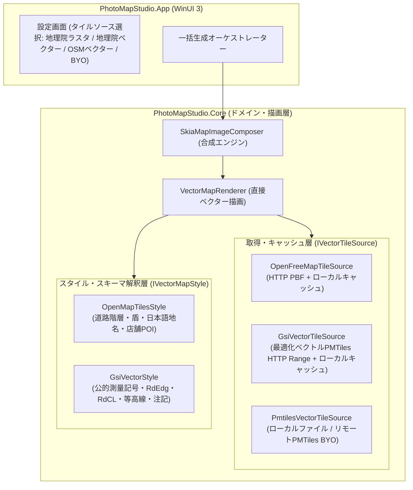

# ベクタータイル直接描画アーキテクチャ設計仕様

## 1. 背景と目的

PhotoMapStudio における地図生成は、これまで国土地理院タイル（ラスター画像）を既定とし、OpenStreetMap（OSM）については利用規約（Tile Usage Policy の一括取得禁止）に配慮してローカルのカスタムサーバー（事前生成済み）経由に限定していました。

しかし、以下の課題と実務要求が存在します：

1. **外部サーバー依存の解消**: 一般利用者に Docker や事前生成サーバーの運用を求めるのは導入負担が大きい。
2. **地域無制限のオンデマンド展開**: 事前生成ではカバー地域が限定されるため、写真の位置情報（EXIF GPS）から必要な領域を自動取得・展開したい。
3. **OSS としての持続性**: 自前のホスティングサーバー（Cloudflare R2 等）をアプリの既定値として抱え込むと、運用コスト・不正利用・費用負担のリスクが生じるため、自前サーバーは持たない。
4. **二大実務ユースケースの両立**:
   - **公的・役所対応（参考位置図）**: 工事写真台帳や各種提出書類・調査報告書の添付位置図において、国土地理院の地形図調（等高線・標高点・公的表記）の参考背景図が求められる。
   - **現場確認・民間・世界対応**: 生活道路名、店舗・施設（POI）、国外写真の対応には OpenStreetMap の詳細データが不可欠である。

本設計では、Core 内蔵の SkiaSharp レンダリングエンジンにより、**中間ラスター（256×256 PNG）を介さずベクタータイルから直接出力画像へ描画・合成する方式（直接ベクター合成描画）** を採用し、OpenStreetMap（OpenFreeMap）と国土地理院（最適化ベクトルタイル）の双方を選択可能なアーキテクチャを確立します。

---

## 2. コア設計: 直接ベクター合成描画（Direct Vector Composition）

### 2.1 ラスター経由方式との比較と狙うアドバンテージ

| 比較項目 | 従来のラスタータイル経由方式 | 直接ベクター合成描画（本設計） |
|---|---|---|
| **文字切れ・重複** | 256×256 タイル境界で道路名や地名が切れる・重複する | **画面全体（例: 800×600）で一括衝突判定・配置するため文字切れ・重複がゼロ** |
| **線の鮮明さ・解像度** | 高ズーム拡大時に線や文字がぼやける | **出力解像度や DPI に応じて常にシャープな線・フォントを描画** |
| **処理オーバーヘッド** | ベクター → PNG エンコード → PNG デコード → 貼り合わせ | **ベクターデータを直接 Skia キャンバスに一発描画（画像変換の無駄がゼロ）** |
| **キャッシュ効率** | 数百〜数千枚の PNG タイルを保存（数十〜数百 MB） | **ソースとなる z14 ベクタータイル数枚（数十 KB〜数 MB）のみを保存** |

### 2.2 システム構成図

---

## 3. レイヤー設計とインターフェース契約

### 3.1 データ取得層 (`IVectorTileSource`)

ベクタータイルの取得元を抽象化し、DI（依存性注入）およびテスト容易性（モック化）を担保します。

- **`GetTileAsync(int z, int x, int y, CancellationToken ct)`**:
  指定されたタイル座標のバイナリ（MVT / PBF）を返します。
- **キャッシュ責務**:
  一度取得したタイルはローカルディスク（`LocalState/tile-cache/`）にキャッシュし、同一セッションおよび次回以降の一括生成でネットワークリクエストを発生させません。
  - キャッシュ鍵は、配信元の識別子（SHA-256 の先頭 8 桁）とズーム・座標（`{hash8}_{z}_{x}_{y}.pbf`）です。配信元が異なるタイルは混ざりません。OpenFreeMap は配信の版（URL に含まれる）を識別子に含めるため、版の更新で以前のキャッシュは使われなくなります。解決した版は `ITileCache` に保存し、オフラインでは前回の版を使います。
  - 保持期間は既定 30 日、容量上限は既定 1 GB（設定画面で変更可）です。上限を超えると、LRU（最終使用日時の古い順）で削除します。この PC 上の PMTiles ファイルはキャッシュしません。
- **メタデータの確定**:
  `PrepareAsync` で、タイル座標の計算前に最大ズームなどの取得元のメタデータ（PMTiles はヘッダー）を確定します。確定できないとき（オフラインなど）は例外にせず、取得の失敗は後続のタイル取得で報告します。
- **取得方式と実装クラス**:
  - `OpenFreeMapTileSource`: OpenFreeMap パブリックエンドポイント（最新 PBF）から取得。固有 User-Agent と並列数制限（最大 4 並列以下）を厳守。提供 maxzoom は 14（過拡大で z15 以上を描画）。
  - `GsiVectorTileSource`: 国土地理院の最適化ベクトルタイル現行仕様に準拠。従来の個別 XYZ PBF（2023年10月で更新停止）ではなく、現行配信である単一 PMTiles（`https://cyberjapandata.gsi.go.jp/xyz/optimal_bvmap-v1/optimal_bvmap-v1.pmtiles`）に対する **HTTP Range 取得** を採用。対応ズームは z4〜16（過拡大で z17〜18 を描画）。
  - `PmtilesVectorTileSource`: PMTiles v3 リーダー実装。国土地理院のリモート PMTiles の HTTP Range 読み取り基盤として共通利用するほか、ユーザー指定のローカル `.pmtiles` ファイルおよび任意のリモート PMTiles URL（BYO）の読み取りを担当。
  - **ユーザー指定の取得元（BYO）**: `VectorSourceSpec` が入力を検証し（http/https のみ、認証情報とフラグメントの拒否、PMTiles は `.pmtiles`、ローカルは絶対パスと存在確認）、`CustomVectorSourceFactory` が取得元と描画スタイルを解決します。種別は PMTiles ファイル／PMTiles URL（HTTP Range）／XYZ URL テンプレートで、XYZ は配信する最大ズームを指定します（PMTiles はヘッダーから分かるため無視）。他者の配信元（HTTP）はキャッシュを通し、125 ミリ秒以上の間隔で 1 接続ずつ要求します。ファイルとループバックは待たず、ファイルは通信せずキャッシュもしません。PMTiles／MVT として読めない内容は、OSM 代替に隠さず理由つきで失敗させます。

### 3.2 スタイル・スキーマ解釈層 (`IVectorMapStyle`)

データスキーマの違い（OpenMapTiles と国土地理院）を吸収し、描画要素（ポリゴン、ライン、シンボル、ラベル）を標準形式でレンダラーに供給します。

- **`OpenMapTilesStyle` (OSM系)**:
  - レイヤー: `transportation`, `transportation_name`, `place`, `poi`, `water`, `landcover`, `building` 等。
  - 道路階層判定: `class`（`motorway`, `trunk`, `primary`, `secondary`, `tertiary`, `minor`, `service`, `path` 等）に基づく色分け・線幅。
  - 経路番号の盾: 高速（緑の角丸）・国道（青の逆三角）・都道府県道（白の五角形）。`network` が日本の経路網（`jp-expressway`・`jp-national`・`jp-prefectural`）ならそれを使い、持たない場合（OpenFreeMap の日本の道路は `road` が多い）は `class` から推定します（`motorway` は高速、`trunk`・`primary` は国道、`secondary`・`tertiary` は都道府県道）。経路番号を盾として優先配置します。道路が過拡大で画面外へ延びる場合も、可視区間の中点に置きます。
  - ラベル: `name:ja` 優先、次いで `name`。道路沿いの傾き配置および施設アイコン。
- **`GsiVectorStyle` (国土地理院系)**:
  - レイヤー: `RdEdg`（道路縁）, `RdCL`（道路中心線）, `BldA`（建物）, `WA`（水域）, `Anno`（注記・地名）, 等高線。
  - 地理院地図調の配色・境界線・標高表示。
  - **適用範囲と非保証事項**: 本スタイルによる描画は、写真台帳や調査報告書における「参考位置図・背景案内図」としての利用を想定したものです。国土地理院の最適化ベクトルタイルは測量法に基づく「基本測量成果」そのものとは位置付けられていないため、法的証明や基本測量成果自体の添付が厳密に義務付けられている用途（不動産登記・境界確定等）の証明能力を保証するものではありません。厳密な測量成果が必須の提出先に対しては、別途正規の測量成果交付データ等の確認・利用を案内します。

### 3.3 レンダリング・合成層 (`VectorMapRenderer`)

SkiaSharp（4.153.1、既存依存）を活用し、出力サイズ（幅 $W$ × 高さ $H$）のキャンバスに以下を直接描画します：

1. **背景・面ポリゴン**: 水域、緑地、土地利用、建物。
2. **線（ライン）**: 道路（外枠 casing と中塗り fill の 2 パス描画）、歩道破線、鉄道ハッチング、河川。
3. **注記・シンボル（ラベル）**:
   - 経路番号の盾（最優先配置）。
   - 道路名（直線区間に傾きを合わせて配置）。
   - 地名・行政界・施設（POI）シンボルと名称。
   - 画面全体を対象とした矩形衝突判定（AABB）による重なり・文字切れの防止。
4. **ピン・出典合成**:
   - 撮影地点へのピン画像（`green_pin.png` 等）の合成。
   - ODbL 帰属表示（`© OpenStreetMap contributors` 等）または国土地理院コンテンツ利用規約に基づく出典焼き込み。

---

## 4. スパイク検証（M0 / M0.5）の実績

repo 外の使い捨て検証（C# / .NET 10 / SkiaSharp）により、成立性を実証済みです：

- **表示品質・情報量**:
  - 対象地域（地方中心部、農地、大都市市街地、国外都市）において、OSM 公式（Carto）と同等水準の視認性を確認。
  - 国道・都道府県道の盾、道路名、町名、駅・病院・学校・店舗等の POI アイコンが自然に配置されることを確認。
  - 地理院淡色ラスタと比較し、細街路や建物形状、店舗情報が大幅に向上。
- **描画性能（Windows 11、開発機実測）**:
  - 地方部（z16〜18）: 1 タイル（約 60 KB）、コールド 70 ms 前後、キャッシュ後 **7 ms**。
  - 大都市部（z18）: 4 タイル（約 3.4 MB）、コールド 200 ms 前後、キャッシュ後 **120 ms**。
  - 1 枚の静止画（800×600）に必要なベクタータイルは 1〜4 枚程度であり、極めて高いキャッシュ命中率を達成。

---

## 5. 段階的実装ロードマップ

| マイルストーン | 主要内容 | 成果物 |
|---|---|---|
| **M0** | アーキテクチャ設計・方針確定・ドキュメント整備 | `docs/development/vector-map-architecture.md`, handoff 参照更新 |
| **M1** | ベクタータイル取得境界・キャッシュ層の抽象化 | `IVectorTileSource`, `VectorTileCache`, モック単体テスト |
| **M2** | Core 内蔵ベクター直描画エンジン（OSM / OpenMapTiles） | `VectorMapRenderer`, `OpenMapTilesStyle`, Core 単体テスト |
| **M3** | UI 連携・設定画面・出典焼き込み・既存パイプライン統合 | WinUI 3 設定UI, プリセット追加, ヘルプ・README更新 |
| **M4** | 国土地理院ベクター対応（最適化PMTiles Range取得） & BYO フォールバック | `GsiVectorStyle`, `optimal_bvmap-v1` PMTiles Range取得, ユーザー指定 PMTiles 対応, レート制御 |

M0〜M4 は実装済みです。ユーザー指定の取得元（BYO）、経路番号の盾、キャッシュの容量上限と LRU を含みます。使い方は [ユーザーガイド](../user-guide.md) を参照してください。
