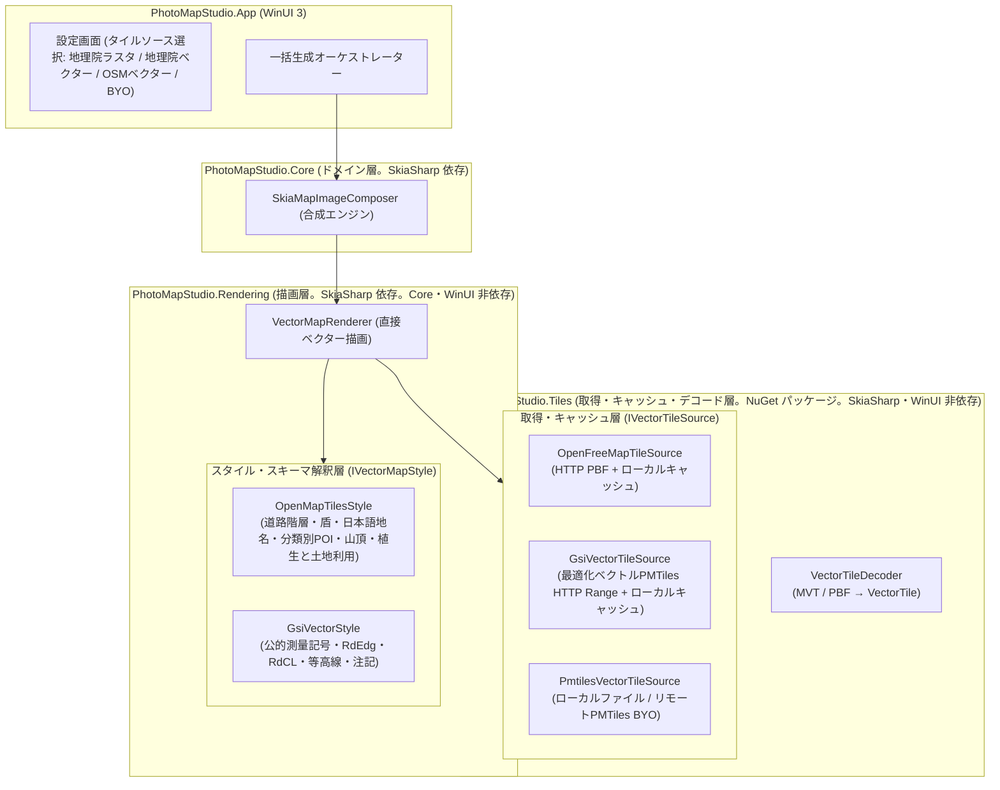

# ベクタータイル直接描画アーキテクチャ設計仕様

## 1. 背景と目的

PhotoMapStudio における地図生成は、これまで国土地理院タイル（ラスター画像）を既定とし、OpenStreetMap（OSM）については利用規約（Tile Usage Policy の一括取得禁止）に配慮してローカルのカスタムサーバー（事前生成済み）経由に限定していました。

しかし、以下の課題と実務要求が存在します：

1. **外部サーバー依存の解消**: 一般利用者に Docker や事前生成サーバーの運用を求めるのは導入負担が大きい。
2. **地域無制限のオンデマンド展開**: 事前生成ではカバー地域が限定されるため、写真の位置情報（EXIF GPS）から必要な領域を自動取得・展開したい。
3. **OSS としての持続性**: 自前のホスティングサーバー（Cloudflare R2 等）をアプリの既定値として抱え込むと、運用コスト・不正利用・費用負担のリスクが生じるため、自前サーバーは持たない。
4. **二大実務ユースケースの両立**:
   - **公的・役所対応（参考位置図）**: 工事写真台帳や各種提出書類・調査報告書の添付位置図において、国土地理院の地形図調（等高線・標高点・公的表記）の参考背景図が求められる。
   - **現場確認・民間・世界対応**: 生活道路名、店舗・施設（POI）、国外写真の対応には OpenStreetMap の詳細データが不可欠である。

本設計では、Core 内蔵の SkiaSharp レンダリングエンジンにより、**中間ラスター（256×256 PNG）を介さずベクタータイルから直接出力画像へ描画・合成する方式（直接ベクター合成描画）** を採用し、OpenStreetMap（OpenFreeMap）と国土地理院（最適化ベクトルタイル）の双方を選択可能なアーキテクチャを確立します。

---

## 2. コア設計: 直接ベクター合成描画（Direct Vector Composition）

### 2.1 ラスター経由方式との比較と狙うアドバンテージ

| 比較項目 | 従来のラスタータイル経由方式 | 直接ベクター合成描画（本設計） |
|---|---|---|
| **文字切れ・重複** | 256×256 タイル境界で道路名や地名が切れる・重複する | **画面全体（例: 800×600）で一括衝突判定・配置するため文字切れ・重複がゼロ** |
| **線の鮮明さ・解像度** | 高ズーム拡大時に線や文字がぼやける | **出力解像度や DPI に応じて常にシャープな線・フォントを描画** |
| **処理オーバーヘッド** | ベクター → PNG エンコード → PNG デコード → 貼り合わせ | **ベクターデータを直接 Skia キャンバスに一発描画（画像変換の無駄がゼロ）** |
| **キャッシュ効率** | 数百〜数千枚の PNG タイルを保存（数十〜数百 MB） | **ソースとなる z14 ベクタータイル数枚（数十 KB〜数 MB）のみを保存** |

### 2.2 システム構成図

### 2.3 パッケージ構成

| プロジェクト | 役割 | 依存 |
|---|---|---|
| `PhotoMapStudio.Tiles` | タイルの取得・キャッシュ・レート制御・デコード。NuGet パッケージ | SkiaSharp・WinUI 非依存 |
| `PhotoMapStudio.Rendering` | ベクター地図の描画（`VectorMapRenderer`・スタイル・注記配置）。NuGet パッケージ。公開手順は [releasing-rendering.md](releasing-rendering.md) | `Tiles`・SkiaSharp。`Core`・WinUI には依存しない |
| `PhotoMapStudio.Core` | EXIF・地図合成（ラスター経路と、ベクター描画の呼び出し）・設定の型 | `Tiles`・`Rendering`・SkiaSharp |
| `PhotoMapStudio.App` | WinUI 3 の UI | `Core` |

- `Rendering` の公開 API は緯度経度（`double`）で位置を受ける。`Core.Geo`（`GeoCoordinate`・`WebMercator`）は `Core` に残し、`Rendering` はメルカトルの式を内部に持つ（`Tiles` の再公開を避け、公開を 1 回にするため）。式が 2 か所になるので、`Core.Tests` の `MercatorProjectionParityTests` で一致を検証する。
- `CustomVectorSourceFactory`（取得元に描画スタイルを組み合わせる）は、取得と描画の両方を知るため `Core` に置く。

---

## 3. レイヤー設計とインターフェース契約

### 3.1 データ取得層 (`IVectorTileSource`)

ベクタータイルの取得元を抽象化し、DI（依存性注入）およびテスト容易性（モック化）を担保します。

- **`GetTileAsync(int z, int x, int y, CancellationToken ct)`**:
  指定されたタイル座標のバイナリ（MVT / PBF）を返します。
- **キャッシュ責務**:
  一度取得したタイルはローカルディスク（`LocalState/tile-cache/`）にキャッシュし、同一セッションおよび次回以降の一括生成でネットワークリクエストを発生させません。
  - キャッシュ鍵は、配信元の識別子（SHA-256 の先頭 8 桁）とズーム・座標（`{hash8}_{z}_{x}_{y}.pbf`）です。配信元が異なるタイルは混ざりません。OpenFreeMap は配信の版（URL に含まれる）を識別子に含めるため、版の更新で以前のキャッシュは使われなくなります。解決した版は `ITileCache` に保存し、オフラインでは前回の版を使います。
  - 保持期間は既定 30 日、容量上限は既定 1 GB（設定画面で変更可）です。上限を超えると、LRU（最終使用日時の古い順）で削除します。この PC 上の PMTiles ファイルはキャッシュしません。
- **メタデータの確定**:
  `PrepareAsync` で、タイル座標の計算前に最大ズームなどの取得元のメタデータ（PMTiles はヘッダー）を確定します。確定できないとき（オフラインなど）は例外にせず、取得の失敗は後続のタイル取得で報告します。
- **取得方式と実装クラス**:
  - `OpenFreeMapTileSource`: OpenFreeMap パブリックエンドポイント（最新 PBF）から取得。固有 User-Agent と並列数制限（最大 4 並列以下）を厳守。提供 maxzoom は 14（過拡大で z15 以上を描画）。
  - `GsiVectorTileSource`: 国土地理院の最適化ベクトルタイル現行仕様に準拠。従来の個別 XYZ PBF（2023年10月で更新停止）ではなく、現行配信である単一 PMTiles（`https://cyberjapandata.gsi.go.jp/xyz/optimal_bvmap-v1/optimal_bvmap-v1.pmtiles`）に対する **HTTP Range 取得** を採用。対応ズームは z4〜16（過拡大で z17〜18 を描画）。
  - `PmtilesVectorTileSource`: PMTiles v3 リーダー実装。国土地理院のリモート PMTiles の HTTP Range 読み取り基盤として共通利用するほか、ユーザー指定のローカル `.pmtiles` ファイルおよび任意のリモート PMTiles URL（BYO）の読み取りを担当。
  - **ユーザー指定の取得元（BYO）**: `VectorSourceSpec` が入力を検証し（http/https のみ、認証情報とフラグメントの拒否、PMTiles は `.pmtiles`、ローカルは絶対パスと存在確認）、`CustomVectorSourceFactory` が取得元と描画スタイルを解決します。種別は PMTiles ファイル／PMTiles URL（HTTP Range）／XYZ URL テンプレートで、XYZ は配信する最大ズームを指定します（PMTiles はヘッダーから分かるため無視）。他者の配信元（HTTP）はキャッシュを通し、125 ミリ秒以上の間隔で 1 接続ずつ要求します。ファイルとループバックは待たず、ファイルは通信せずキャッシュもしません。PMTiles／MVT として読めない内容は、OSM 代替に隠さず理由つきで失敗させます。

### 3.2 スタイル・スキーマ解釈層 (`IVectorMapStyle`)

データスキーマの違い（OpenMapTiles と国土地理院）を吸収し、描画要素（ポリゴン、ライン、シンボル、ラベル）を標準形式でレンダラーに供給します。

- **`OpenMapTilesStyle` (OSM系)**:
  - レイヤー: `transportation`, `transportation_name`, `place`, `poi`, `water`, `landcover`, `building` 等。
  - 道路階層判定: `class`（`motorway`, `trunk`, `primary`, `secondary`, `tertiary`, `minor`, `service`, `path` 等）に基づく色分け・線幅。
  - 経路番号の盾: 高速（緑の角丸）・国道（青の逆三角）・都道府県道（白の五角形）。種別は、道路が属する路線関係の経路網で決めます。OpenFreeMap は `route_1_network`〜`route_4_network`・`route_N_ref` に OSM の路線関係を持ち（`JP:national` は国道、`JP:prefectural` は都道府県道、`JP:E`・`JP:expressway*` は高速）、Protomaps 系のタイルは `network`（`jp-national` など）に持ちます。複数の路線を持つ道路は高速、国道、都道府県道の順に優先し、番号は選んだ路線の `ref` を使います。路線関係を持たない道路には、`class` からの推定は行わず盾を描きません（推定は国道の盾を取り違えるため。根拠は [road-class-validation.md](road-class-validation.md)）。経路番号を盾として優先配置します。道路が過拡大で画面外へ延びる場合も、可視区間の中点に置きます。
  - ラベル: `name:ja` 優先、次いで `name`。道路沿いの傾き配置および施設アイコン。
  - 山頂（`mountain_peak`）: 三角の記号・山名・標高（`ele`）。火山は赤、他は茶色。ズーム 11 未満は描かず、11〜13 は `rank`（タイル内の標高順）の上位だけ、14 以上は全て描く。描くのは `class` が `peak`・`volcano` の地物だけで、峠・鞍部（`saddle`）、崖（`cliff`）、名前のない地物は描きません（`OpenMapTilesPeakSymbols`）。
  - POI（`poi`）: `class` を 10 分類（交通・駐車場・医療・飲食・買い物・宿泊・教育・文化・公園運動・その他）に分け、分類ごとの色と形（駐車場は「P」の四角、医療は十字の円、他は円）で描きます。注記の文字色は記号の色を暗くした色です。名前のない施設は描きませんが、駐車場だけは、ズーム 16 以上で記号だけを描きます（`OpenMapTilesPoiSymbols`）。
  - 面の色（`landcover`・`landuse`）は `OpenMapTilesLandPalette` にまとめています。`park` レイヤーは、用途を表す `recreation_ground`・`historic` だけを塗ります。国立公園・保護区などの指定区域（`national_park`・`nature_reserve`・`conservation`・`wilderness_preserve`・`wildlife_refuge`・`marine`、保護区の名称の自由記述の値など）は範囲を示すだけなので塗りません（塗ると、範囲内の植生・岩が全面に隠れて山地が一色になります）。値が自由記述まで広がるため、除く値ではなく塗る区分を列挙しています。
  - 森の樹木の模様: ズーム 14 以上で、植生の森（`landcover` の `wood`）を面でクリップし、格子上の樹冠と幹を 1 回の `DrawPoints` で描きます（`OpenMapTilesTreeTexture`）。繰り返しパターンのシェーダーで面全体を塗る方式は、面の全画素を塗り直すため、森が画面の大半を占める表示で描画時間が数倍になるので採りません（実測は [CHANGELOG](../../CHANGELOG.md) を参照）。
  - バス停・鉄道駅は、円とは違う四角の記号で描きます。バス停はズーム 16 以上、駅はズーム 15 以上です。
  - ロープウェイ（`transportation` の `class=aerialway`）は灰色の線と点、小道は種類（`subclass`）で色を分けます（自転車道は青、歩道・階段などは赤みのある茶色、それ以外は茶色）。
  - 林道（`class=track`）は、道路（casing つきの実線）ではなく、小道（`path`）と同じ枠組みの破線で、小道より少し太く（1.6）長い（線 6・間 3 の論理ピクセル）濃い茶色で描きます。舗装路（`service`・`minor` など）の白い道と区別でき、道路網より目立ちません。破線は、範囲と交わる区間だけを位相を合わせて描く最適化（§3.4）の対象です。舗装路の下に描くため、交差部では舗装路の中塗りが残ります。林道の名前（`transportation_name`）は、ズーム 14 以上から描きます（他の小道〔`path`・`footway` など〕はズーム 17 以上のまま）。林道・小道・`living_street` の名前（最低ランク）は、番地と同じ最も低い優先度の段階（`RenderLowPriorityLabels`）で置き、先に置かれた注記と重なる所には描きません。道路名の段階に置くと、ランクの並べ替えはタイル内だけで衝突グリッドは全タイルで共有されるため、先に走査したタイルの林道名が、隣のタイルの上位の道路名を境界付近で押しのけます。
  - 水路（`waterway`）の線幅は `class` で決め（川 4・運河 3・沢・溝・排水路など 1.8。論理ピクセル）、`ZoomScale` と同じ伸び方で拡縮します。川が沢より太くなり、ズームによらず比は一定です（以前は全て 2.5）。
  - 番地（`housenumber`）は、ズーム 17 以上で、8 文字以下で空白を含まない値だけを、最も低い優先度で描きます（`OpenMapTilesHouseNumbers`）。全タイルの通常の注記を置いた後に置くため、`IVectorMapStyle.RenderLowPriorityLabels`（既定の実装は何も描かない）で描き、`RenderLabels` の中では描きません（タイルごとに置くと、先に走査したタイルの番地が隣のタイルの駅・施設名を押しのけるため）。
  - 記号・注記の寸法は論理ピクセルで、`PixelRatio` で拡大されます。物理ピクセルの固定値は持ちません。
- **`GsiVectorStyle` (国土地理院系)**:
  - レイヤー: `RdEdg`（道路縁）, `RdCL`（道路中心線）, `BldA`（建物）, `WA`（水域）, `Anno`（注記・地名）, 等高線。
  - 地理院地図調の配色・境界線・標高表示。
  - **適用範囲と非保証事項**: 本スタイルによる描画は、写真台帳や調査報告書における「参考位置図・背景案内図」としての利用を想定したものです。国土地理院の最適化ベクトルタイルは測量法に基づく「基本測量成果」そのものとは位置付けられていないため、法的証明や基本測量成果自体の添付が厳密に義務付けられている用途（不動産登記・境界確定等）の証明能力を保証するものではありません。厳密な測量成果が必須の提出先に対しては、別途正規の測量成果交付データ等の確認・利用を案内します。

### 3.3 レンダリング・合成層 (`VectorMapRenderer`)

SkiaSharp（4.153.1、既存依存）を活用し、出力サイズ（幅 $W$ × 高さ $H$）のキャンバスに以下を直接描画します：

1. **背景・面ポリゴン**: 水域、緑地、土地利用、建物。
2. **線（ライン）**: 道路（外枠 casing と中塗り fill の 2 パス描画）、歩道破線、鉄道ハッチング、河川。
3. **注記・シンボル（ラベル）**:
   - 経路番号の盾（最優先配置）。
   - 道路名（直線区間に傾きを合わせて配置）。
   - 地名・行政界・施設（POI）シンボルと名称。
   - 画面全体を対象とした矩形衝突判定（AABB）による重なり・文字切れの防止。
4. **ピン・出典合成**:
   - 撮影地点へのピン画像（`green_pin.png` 等）の合成。
   - ODbL 帰属表示（`© OpenStreetMap contributors` 等）または国土地理院コンテンツ利用規約に基づく出典焼き込み。

### 3.4 表示範囲の描画 API (`VectorMapRenderer.RenderViewAsync`)

`IVectorMapRenderer` は、この `RenderViewAsync` だけを持つ契約で、`Core`（`SkiaMapImageComposer`）もこの API で描く。`Core` は、合成先と同じ色形式（Rgba8888）を `ColorType` で指定し、返された画像を合成先へそのまま描く（ピンなどを重ねる前の画素が、直接描いた場合と一致する）。

PhotoGeoExplorer など、表示範囲全体を 1 枚の画像として描く利用者向けの API（#130 の PR B1）。要求（`VectorViewRequest`）を受け、結果（`VectorViewResult`）を返す。

- **連続ズーム**: `Zoom` は `double`。取得するタイルのズームは `min(floor(Zoom), 取得元の最大ズーム)`、表示倍率は `2^(Zoom − 取得ズーム)`、スタイルへ渡すズームは `floor(Zoom)`（`PixelRatio` を指定したときは、画素密度を除いた論理ズーム `floor(Zoom − log2(PixelRatio))` で、表示倍率も論理ピクセルで求める。次項）。整数ズームでは、従来の整数ズーム専用の API（`RenderMapAsync` / `RenderToCanvasAsync`。#130 の PR B3a で削除）と同じ描き方になる。
- **物理ピクセル寸法**: 画像の寸法とズームは物理ピクセルで指定する（ウィンドウの DPI との丸めの差を避けるため、呼び出し側が表示の物理ピクセルに合わせた寸法とズームを渡す）。表示の画素密度は `PixelRatio` で別に伝える（次項）。
- **画素密度（`PixelRatio`。#144）**: 既定は 1.0。スタイルの大きさ（文字・縁取り・点・盾・線幅。いずれも物理ピクセルの固定値や `ZoomScale(整数ズーム)`）は物理ピクセルで決まるため、画素密度の高い表示では、論理ピクセル（画面上）では小さくなる（PhotoGeoExplorer の実測では、150% で OSM の約 0.7 倍、200% で約 0.55 倍）。`PixelRatio` を指定すると、`RenderCoreAsync` が、スタイルの判定に使うズーム（`floor(Zoom − log2(PixelRatio))`）、タイルの拡大率、表示範囲、注記の衝突判定の範囲を**論理ピクセル**で求め、キャンバスを `PixelRatio` 倍に拡大して描く（MapLibre の pixelRatio と同じ考え方）。`IVectorMapStyle` は変更しないので、スタイルの実装は無改修で、文字・線幅が論理ピクセルでは画素密度によらず一定になり、画像は物理ピクセルのまま鮮明に描かれる。帯の並列描画は、帯の位置（物理ピクセルの行）へ移動してから拡大し、注記を別画像へ描く経路は、その画像のキャンバスを拡大して、拡大しない本体のキャンバスへ重ねる。取得するタイルのズームと範囲は、従来どおり物理ピクセルの `Zoom`・画像寸法から求める（事前デコードと取得ズームを一致させ、取得するタイルの集合が `PixelRatio` に依らないようにする。論理ピクセルへ換算してから範囲を求めると、タイルの境界ちょうどの範囲で浮動小数点の誤差により画面外のタイルを余分に取得し得る）。描くときの位置・拡大率だけを `PixelRatio` で割って論理ピクセルにする。`PixelRatio` は `MinPixelRatio`（1/16）〜`MaxPixelRatio`（16）の範囲だけを受け付け、範囲外（極端な値や非有限）は、論理寸法・座標が非有限になったり Skia へ渡す倍率が 0・無限大になったりして背景だけの画像が成功として返るため、描画の前に `ArgumentOutOfRangeException` にする。`PixelRatio` が 1.0 のときは、従来と画素単位で同じ画像になる（既存のテストと、指定しない要求との一致テストで確認）。
- **画像の所有**: 描画のたびに新しい画像を作り、共有・再利用しない。画像は `VectorViewResult`（`IDisposable`）が所有し、`Dispose` で破棄する。呼び出し側が引き取るときは `TakeImage()` を使う（以後、結果は画像を破棄しない）。
- **キャンセル**: 取得・各描画パスのタイルごと・描画の完了後に加えて、スタイルの中（`IVectorMapStyle` の各メソッドが受けるトークン）でレイヤー・地物の単位で確認する。キャンセルされたら `OperationCanceledException` で終わる（画像を返さない）。並列描画中も、包まれず `OperationCanceledException` になる。
- **欠落の判別**: `AllowIncompleteMaps` を指定すると、一時的な通信失敗・通信停止中のキャッシュ未命中のタイルを欠落として許し、`UnavailableTileCount`（通信失敗）・`AbsentTileCount`（配信範囲外）・`IsComplete` で判別できる。既定では許さず、失敗は `TileFetchException` になる。
- **並列描画**（#130 の PR B2。既定は無効）: `BandCount` を 2 以上にすると、面・線を、画像を横に分けた帯ごとに並列で描く（帯は連続した行なので、同じ画素メモリの別範囲を別のサーフェスで描ける）。`ParallelLabels` を有効にすると、注記を別スレッドの透明な画像へ描いて最後に重ねる（注記の衝突判定は逐次で、全タイルのシンボル → 道路名 → その他の順は変わらない）。最良の帯の数はコア数に近く、コア数より多いと遅くなり得る。並列にすると、線・注記の縁の半透明画素が、並列にしない場合と最大 20 程度（/255）ずれ得る（見た目は同じ）。スタイルの描画メソッドは、同じインスタンスに対して別のキャンバスから並行して呼ばれるため、共有のペイントを書き換えない。
- **デコード済みキャッシュ**: `VectorMapRenderer` に `DecodedTileCache`（LRU。容量はデコード時のメモリ割り当て量の見積もりの合計）を渡すと、同じタイルの取得とデコードを省く（欠落したタイルは覚えない）。鍵は、取得元の識別子を非同期に解決した値（動的に版を解決する取得元では解決後の版）で作り、同じ識別子でタイルを取得する。取得の間に識別子が変わったタイルは保存しない。通信を止めている間は、解決せず解決前の識別子を使う。キャッシュは新旧どちらの描画 API でも使われる。
- **事前デコード**: `IVectorMapPrefetcher.PrefetchAsync`（`VectorMapRenderer` が実装。`IVectorMapRenderer` とは別の契約にし、利用側の既存の実装を壊さない）は、描画せずに、取得ズームで中心を囲む 2×2 枚の取得・デコードだけを行い、デコード済みキャッシュへ入れる（PoC の事前デコードの還元。#138）。取得・デコード・保存は描画と同じ `LoadTileAsync` を共有し、版の解決・保存しない条件を二重管理しない。`DecodedTileCache` なしでは効果がないので `InvalidOperationException`、取得の失敗・読めない内容は `TileFetchException`（握りつぶさない）、配信範囲外は飛ばす。タイルは 1 枚ずつ逐次に取得し、デコードが済んだものだけを入れる（キャンセルで半端なタイルは入らない）。描画との同時呼び出しは、同じタイルの二重のデコードを許容する（キャッシュは lock 済みで上書きのため壊れない。進行中の取得の集約は、キャンセルの伝播が複雑になるため入れない）。
- **表示範囲外の地物を描かない最適化**（`OpenMapTilesStyle`）: 描画先の範囲（キャンバスのクリップ）と交わらない地物は、パスを作る前に除外する。出力は変わらない（保存済みタイルの SHA-256 が一致）。破線の小道は、範囲と交わる区間だけを、元のパスの始点からの距離で破線の位相を合わせて描く。Skia は破線をパスの全長に対して生成するため、深いズームで長い小道の大半が画面外になると、画面外の処理が支配的になる（線の描画が、タイル境界の z19 で約 97 ms → 10 ms、z17 で約 45 ms → 19 ms）。位相は double で求めるため、基準（Skia が float で累積）と破線の縁の半透明画素が数画素だけずれ得る（見た目は同じ）。
- **取り込まなかった PoC の最適化**: パスの事前生成（初回コストが大きく効果もほぼ無い）、道路のバッチ化・小面積の間引き・小道の間引き（効果が小さい、または見た目が変わる）、タイルの並列デコード（効果が小さい）。

---

## 4. スパイク検証（M0 / M0.5）の実績

repo 外の使い捨て検証（C# / .NET 10 / SkiaSharp）により、成立性を実証済みです：

- **表示品質・情報量**:
  - 対象地域（地方中心部、農地、大都市市街地、国外都市）において、OSM 公式（Carto）と同等水準の視認性を確認。
  - 国道・都道府県道の盾、道路名、町名、駅・病院・学校・店舗等の POI アイコンが自然に配置されることを確認。
  - 地理院淡色ラスタと比較し、細街路や建物形状、店舗情報が大幅に向上。
- **描画性能（Windows 11、開発機実測）**:
  - 地方部（z16〜18）: 1 タイル（約 60 KB）、コールド 70 ms 前後、キャッシュ後 **7 ms**。
  - 大都市部（z18）: 4 タイル（約 3.4 MB）、コールド 200 ms 前後、キャッシュ後 **120 ms**。
  - 1 枚の静止画（800×600）に必要なベクタータイルは 1〜4 枚程度であり、極めて高いキャッシュ命中率を達成。

---

## 5. 段階的実装ロードマップ

| マイルストーン | 主要内容 | 成果物 |
|---|---|---|
| **M0** | アーキテクチャ設計・方針確定・ドキュメント整備 | `docs/development/vector-map-architecture.md`, handoff 参照更新 |
| **M1** | ベクタータイル取得境界・キャッシュ層の抽象化 | `IVectorTileSource`, `VectorTileCache`, モック単体テスト |
| **M2** | Core 内蔵ベクター直描画エンジン（OSM / OpenMapTiles） | `VectorMapRenderer`, `OpenMapTilesStyle`, Core 単体テスト |
| **M3** | UI 連携・設定画面・出典焼き込み・既存パイプライン統合 | WinUI 3 設定UI, プリセット追加, ヘルプ・README更新 |
| **M4** | 国土地理院ベクター対応（最適化PMTiles Range取得） & BYO フォールバック | `GsiVectorStyle`, `optimal_bvmap-v1` PMTiles Range取得, ユーザー指定 PMTiles 対応, レート制御 |

M0〜M4 は実装済みです。ユーザー指定の取得元（BYO）、経路番号の盾、キャッシュの容量上限と LRU を含みます。使い方は [ユーザーガイド](../user-guide.md) を参照してください。
