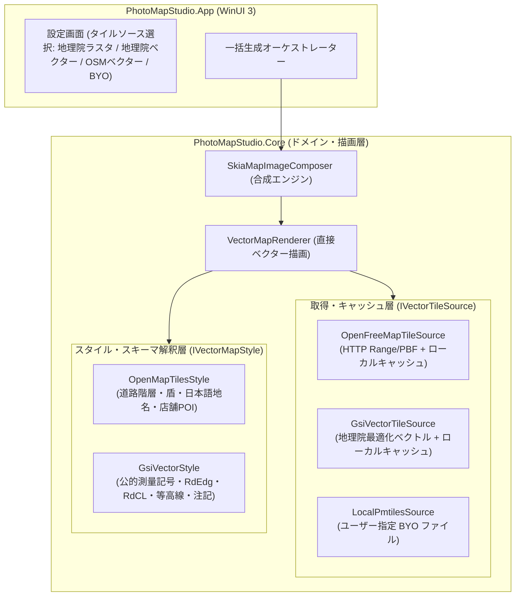

# ベクタータイル直接描画アーキテクチャ設計仕様

## 1. 背景と目的

PhotoMapStudio における地図生成は、これまで国土地理院タイル（ラスター画像）を既定とし、OpenStreetMap（OSM）については利用規約（Tile Usage Policy の一括取得禁止）に配慮してローカルのカスタムサーバー（事前生成済み）経由に限定していました。

しかし、以下の課題と実務要求が存在します：

1. **外部サーバー依存の解消**: 一般利用者に Docker や事前生成サーバーの運用を求めるのは導入負担が大きい。
2. **地域無制限のオンデマンド展開**: 事前生成ではカバー地域が限定されるため、写真の位置情報（EXIF GPS）から必要な領域を自動取得・展開したい。
3. **OSS としての持続性**: 自前のホスティングサーバー（Cloudflare R2 等）をアプリの既定値として抱え込むと、運用コスト・不正利用・費用負担のリスクが生じるため、自前サーバーは持たない。
4. **二大実務ユースケースの両立**:
   - **公的・役所対応**: 提出書類や工事・調査報告等で国土地理院の地形図（測量成果・等高線・公的基準）が必要とされる。
   - **現場確認・民間・世界対応**: 生活道路名、店舗・施設（POI）、国外写真の対応には OpenStreetMap の詳細データが不可欠である。

本設計では、Core 内蔵の SkiaSharp レンダリングエンジンにより、**中間ラスター（256×256 PNG）を介さずベクタータイルから直接出力画像へ描画・合成する方式（直接ベクター合成描画）** を採用し、OpenStreetMap（OpenFreeMap）と国土地理院（最適化ベクトルタイル）の双方を選択可能なアーキテクチャを確立します。

---

## 2. コア設計: 直接ベクター合成描画（Direct Vector Composition）

### 2.1 ラスター経由方式との比較と狙うアドバンテージ

| 比較項目 | 従来のラスタータイル経由方式 | 直接ベクター合成描画（本設計） |
|---|---|---|
| **文字切れ・重複** | 256×256 タイル境界で道路名や地名が切れる・重複する | **画面全体（例: 800×600）で一括衝突判定・配置するため文字切れ・重複がゼロ** |
| **線の鮮明さ・解像度** | 高ズーム拡大時に線や文字がぼやける | **出力解像度や DPI に応じて常にシャープな線・フォントを描画** |
| **処理オーバーヘッド** | ベクター → PNG エンコード → PNG デコード → 貼り合わせ | **ベクターデータを直接 Skia キャンバスに一発描画（画像変換の無駄がゼロ）** |
| **キャッシュ効率** | 数百〜数千枚の PNG タイルを保存（数十〜数百 MB） | **ソースとなる z14 ベクタータイル数枚（数十 KB〜数 MB）のみを保存** |

### 2.2 システム構成図

---

## 3. レイヤー設計とインターフェース契約

### 3.1 データ取得層 (`IVectorTileSource`)

ベクタータイルの取得元を抽象化し、DI（依存性注入）およびテスト容易性（モック化）を担保します。

- **`GetTileAsync(int z, int x, int y, CancellationToken ct)`**:
  指定されたタイル座標のバイナリ（MVT / PBF）を返します。
- **キャッシュ責務**:
  一度取得したタイルはローカルディスク（`LocalState/vector-cache/` 等）にキャッシュし、同一セッションおよび次回以降の一括生成でネットワークリクエストを発生させません。
- **実装クラス**:
  - `HttpVectorTileSource`: OpenFreeMap などのパブリックエンドポイントから取得。固有 User-Agent と並列数制限（最大 4 並列以下）を厳守。
  - `GsiVectorTileSource`: 国土地理院の最適化ベクトルタイル配信（`experimental_bvmap`）から取得。
  - `PmtilesVectorTileSource`: ユーザー指定のローカル `.pmtiles` ファイルを読み取り（BYO）。

### 3.2 スタイル・スキーマ解釈層 (`IVectorMapStyle`)

データスキーマの違い（OpenMapTiles と国土地理院）を吸収し、描画要素（ポリゴン、ライン、シンボル、ラベル）を標準形式でレンダラーに供給します。

- **`OpenMapTilesStyle` (OSM系)**:
  - レイヤー: `transportation`, `transportation_name`, `place`, `poi`, `water`, `landcover`, `building` 等。
  - 道路階層判定: `class`（`motorway`, `trunk`, `primary`, `secondary`, `tertiary`, `minor`, `service`, `path` 等）に基づく色分け・線幅。
  - 経路番号の盾: `ref`, `route_1_network`, `route_1_ref` による国道（青三角）・都道府県道（白地五角形）・高速（緑角丸）の優先配置。
  - ラベル: `name:ja` 優先、次いで `name`。道路沿いの傾き配置および施設アイコン。
- **`GsiVectorStyle` (国土地理院系)**:
  - レイヤー: `RdEdg`（道路縁）, `RdCL`（道路中心線）, `BldA`（建物）, `WA`（水域）, `Anno`（注記・地名）, 等高線。
  - 役所提出用図面に準拠した測量図的配色・境界線・標高表示。

### 3.3 レンダリング・合成層 (`VectorMapRenderer`)

SkiaSharp（4.153.1、既存依存）を活用し、出力サイズ（幅 $W$ × 高さ $H$）のキャンバスに以下を直接描画します：

1. **背景・面ポリゴン**: 水域、緑地、土地利用、建物。
2. **線（ライン）**: 道路（外枠 casing と中塗り fill の 2 パス描画）、歩道破線、鉄道ハッチング、河川。
3. **注記・シンボル（ラベル）**:
   - 経路番号の盾（最優先配置）。
   - 道路名（直線区間に傾きを合わせて配置）。
   - 地名・行政界・施設（POI）シンボルと名称。
   - 画面全体を対象とした矩形衝突判定（AABB）による重なり・文字切れの防止。
4. **ピン・出典合成**:
   - 撮影地点へのピン画像（`green_pin.png` 等）の合成。
   - ODbL 帰属表示（`© OpenStreetMap contributors` 等）または国土地理院コンテンツ利用規約に基づく出典焼き込み。

---

## 4. スパイク検証（M0 / M0.5）の実績

repo 外の使い捨て検証（C# / .NET 10 / SkiaSharp）により、成立性を実証済みです：

- **表示品質・情報量**:
  - 対象地域（地方中心部、農地、大都市市街地、国外都市）において、OSM 公式（Carto）と同等水準の視認性を確認。
  - 国道・都道府県道の盾、道路名、町名、駅・病院・学校・店舗等の POI アイコンが自然に配置されることを確認。
  - 地理院淡色ラスタと比較し、細街路や建物形状、店舗情報が大幅に向上。
- **描画性能（Windows 11、開発機実測）**:
  - 地方部（z16〜18）: 1 タイル（約 60 KB）、コールド 70 ms 前後、キャッシュ後 **7 ms**。
  - 大都市部（z18）: 4 タイル（約 3.4 MB）、コールド 200 ms 前後、キャッシュ後 **120 ms**。
  - 1 枚の静止画（800×600）に必要なベクタータイルは 1〜4 枚程度であり、極めて高いキャッシュ命中率を達成。

---

## 5. 段階的実装ロードマップ

| マイルストーン | 主要内容 | 成果物 |
|---|---|---|
| **M0** (本PR) | アーキテクチャ設計・方針確定・ドキュメント整備 | `docs/vector-map-architecture.md`, handoff 参照更新 |
| **M1** | ベクタータイル取得境界・キャッシュ層の抽象化 | `IVectorTileSource`, `VectorTileCache`, モック単体テスト |
| **M2** | Core 内蔵ベクター直描画エンジン（OSM / OpenMapTiles） | `VectorMapRenderer`, `OpenMapTilesStyle`, Core 単体テスト |
| **M3** | UI 連携・設定画面・出典焼き込み・既存パイプライン統合 | WinUI 3 設定UI, プリセット追加, ヘルプ・README更新 |
| **M4** | 国土地理院ベクター対応 & BYO フォールバック | `GsiVectorStyle`, ユーザー指定 PMTiles 対応, レート制御 |
